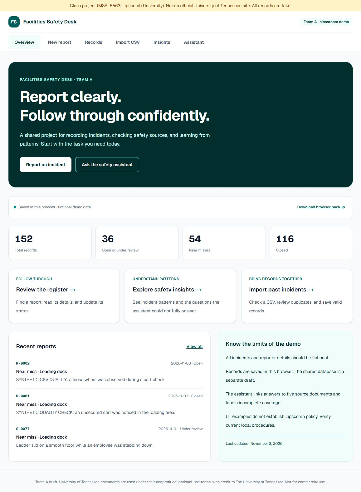
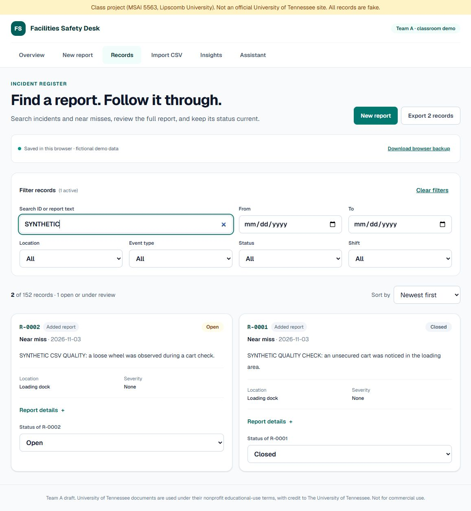
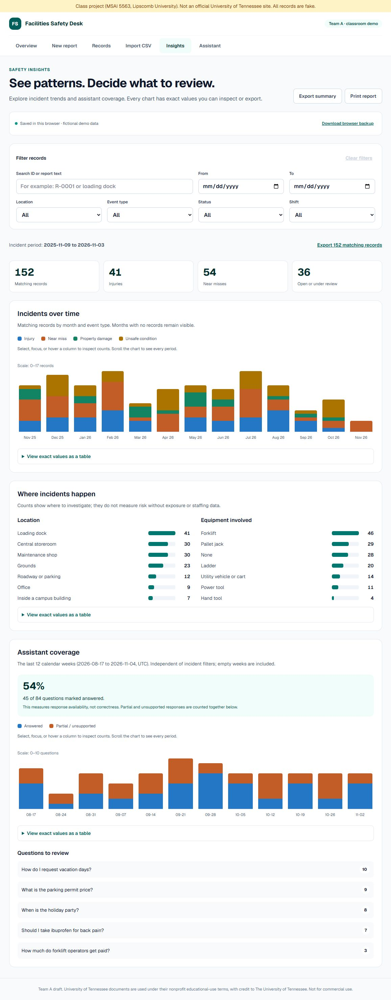

# Full-app draft for team review

> **Status, November 5, 2026.** Written on November 3 for draft pull request #6, which was merged into a side branch and never reached `master`. Its work is now part of one consolidated pull request. This file is kept as the record of what was built and checked on that date, so branch names, pull request numbers, port 3102 and "nothing has been merged" statements describe November 3. For current setup and deployment steps, use the root [README](../README.md) and [DEPLOYMENT.md](DEPLOYMENT.md).

This proposal builds on #5 and keeps the group's application, source material and original last-updated feature. It changes the user's experience across the app and fixes local data behavior. It is not merged into production.

## What changed

| Area | Result |
| --- | --- |
| Overview and navigation | Clear primary tasks, live demo counts, recent reports, consistent navigation, current-page labels and a keyboard skip link. The obsolete claim that no AI exists is removed. |
| Incident form | Unfinished entries survive navigation within the same tab. Saving clears the draft. Confirmed saves remain distinct from unsaved drafts. |
| Records | Text/ID search, date/category/status filters, ordering, readable cards, full record details, useful empty results and filtered export. Status feedback follows a successful storage write. |
| Import | Reuses the hardened CSV parser, validates headers/row shape, handles file-read failures and stale selections, previews new rows, downloads all row errors, and skips exact duplicates by default. Reimport checks current records while holding the local write lock. |
| Insights | Monthly values cover the filtered interval; zero months remain visible. Assistant coverage uses exactly twelve calendar weeks, including empty weeks, and is labeled as availability rather than accuracy. Exact tables and exports support the charts. |
| Local data | Validates stored shapes, preserves unreadable data, offers a raw JSON backup, anchors sample dates, confirms writes, and refreshes other tabs. Web Locks serialize writes where available. There is no destructive reset control. |
| Accessibility and print | Larger controls, visible focus, keyboard/touch chart inspection, responsive layouts, repeating table headers and compact print styles with the fictional-data label retained. |

## Observed verification

- 19 app/storage/CSV checks and 38 assistant/contract checks passed. Lint, TypeScript and the production build passed.
- A fictional report was started, the user-facing navigation moved away and back, and its draft was restored. It saved as R-0001 with a confirmed ID.
- R-0001 changed to Closed and appeared Closed in a second tab. Its downloaded CSV contained the confirmed status.
- A mixed file had three valid rows, one invalid email, and two exact duplicates. It imported one new record and skipped the other three rows. Reimport showed zero new records available; the invalid row was correctly identified as row 5.
- The browser backup contained both added records and the Closed status. Filtered summary export reported one matching record and zero open records.
- The monthly chart's exact table summed to 152, matching the register. Combined text/status filters reduced both the table and export to one record.
- The source-backed assistant answered through the revised storage path. Questions remain part of the demo's statistics; clearing the visible conversation does not erase them.
- All six routes were checked at 320px with no horizontal page overflow. Records, Insights and Assistant were also checked at 768px. Charts may scroll inside their own containers.
- The printable report was rendered and visually checked across four landscape pages. Tables continue with headers; the keyboard skip link and download controls are excluded.

These are AI-run development checks with fictional data. They do not establish independent user acceptance, a security audit, or a 9.98/10 score.

## Screenshots

Overview:

Record review:

Insights:

## Remaining team work

Shared hosted PostgreSQL and access controls still need integration and verification. This branch retains browser-local storage and optional local Ollama. When combining with #3, use the server store and server-side question logging; preserve these validation and feedback behaviors. Do not connect a public browser directly to local Ollama or copy credentials into client code.

Catherine and Kai should review the flows and priorities through the normal team process. No assignments, dates, student hours or production approval have been added. AI-assisted implementation by Codex at Forrest's direction.
