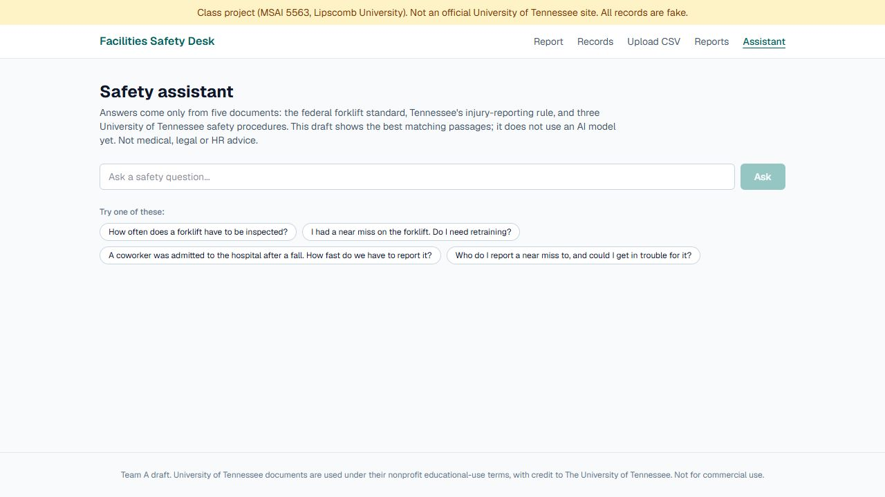
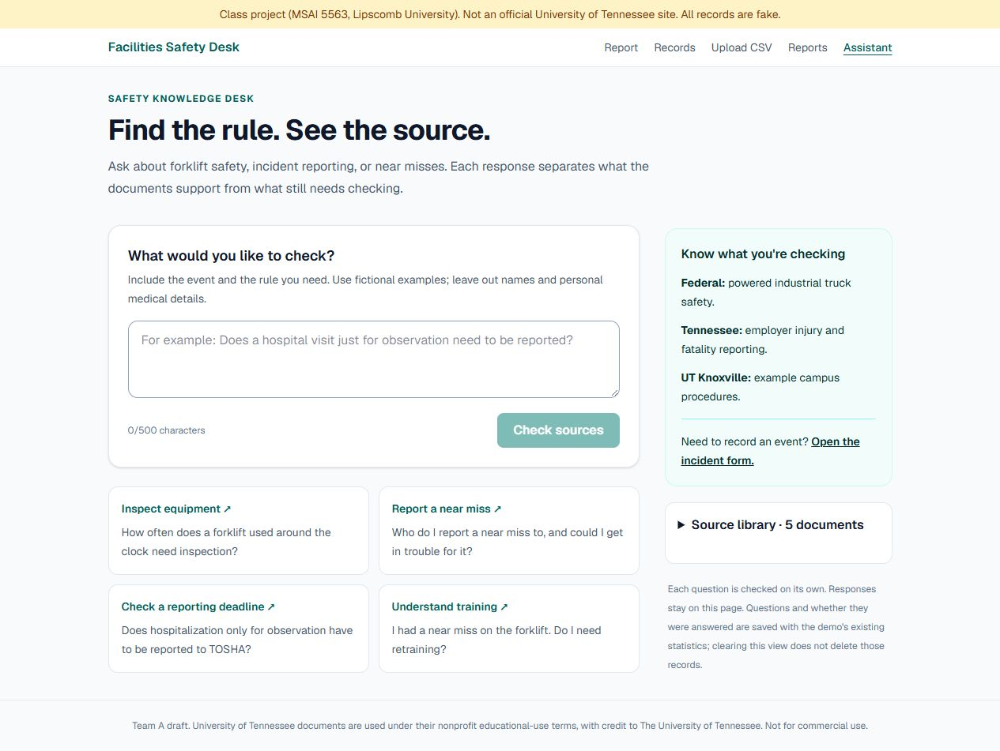
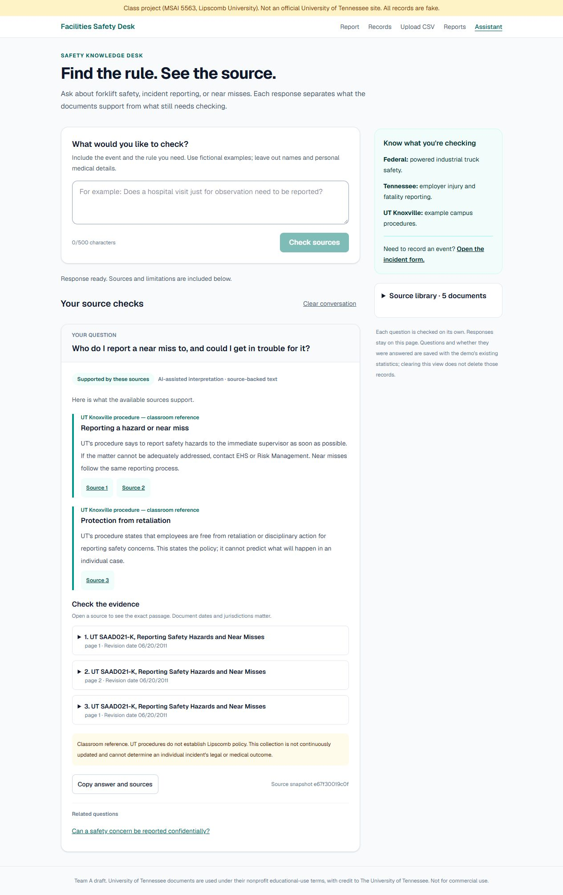

# Assistant draft for team review

> **Status, November 5, 2026.** Written on November 3 for draft pull request #5, which was merged into a side branch and never reached `master`. Its work is now part of one consolidated pull request. This file is kept as the record of what was built and checked on that date, so branch names, pull request numbers, port 3102 and "nothing has been merged" statements describe November 3. For current setup and deployment steps, use the root [README](../README.md) and [DEPLOYMENT.md](DEPLOYMENT.md).

The original assistant returned matching passages, sometimes missing the actual answer, a second part of a question, or a source exception. This draft adds a source-backed answer guide, optional local AI interpretation, and a clearer evidence interface. It remains a classroom prototype using fictional examples.

## What changes

- Fourteen source-backed topics cover inspections, training, unsafe equipment, incident/hazard reporting, confidentiality, retaliation, Tennessee reporting conditions, retention, and unattended forklifts.
- Every guide section links to full source passages. Federal rules, Tennessee employer requirements, and UT Knoxville procedures have distinct scope labels.
- Unsupported jurisdictions, missing local policies/contacts, product-specific chemical advice, medical/HR requests, and incident-record lookups are kept outside the supported answer path.
- A return-to-work clearance question stays partial even if the model considers the policy sufficient. More than four selected topics also produces partial coverage.
- Optional Ollama interpretation maps paraphrases to supplied topics and can select exact candidate passages for other questions. Selected IDs must exist in the supplied catalog. The model cannot write the displayed policy text, fabricate citations, or call tools. Generic passage selections remain partial, with surrounding text visible.
- Model failure, malformed output, an occupied interpreter, or timeout falls back explicitly to the source guide/search. The endpoint has a bounded JSON body and cross-site request checks. These checks are not authentication.
- The interface provides clear supported/partial/unsupported states, expandable evidence, source-library links, copy with citations, related questions, cancellation, retry and accessible status messages. Questions are independent. Clearing the visible conversation does not erase existing question-statistics records.

## Sources and provenance

`src/data/documents.json` is preserved. An additive supplement restores the second paragraph of OSHA 1910.178(q)(7), omitted in the original extraction, about round-the-clock inspections after each shift and correcting defects. It was checked against [OSHA's official text](https://www.osha.gov/laws-regs/regulations/standardnumber/1910/1910.178) on November 3, 2026. Citation labels for combined excerpts are expanded to describe their actual section range. Existing UT dates and attribution remain visible; the corpus is not described as continuously current.

Answer-guide wording is an AI-prepared interpretation for team review, not newly issued policy. The source snapshot hash identifies the supplied evidence and guide text; it is not a claim that all laws were revalidated. The source guide uses fixed, cited summaries; it is not unrestricted generative legal advice.

The local adapter follows [Ollama's structured-output interface](https://docs.ollama.com/capabilities/structured-outputs). `ASSISTANT_OLLAMA_MODEL` enables an installed model. The endpoint is fixed to loopback, with an 8K context, bounded output, 45-second request timeout, one interpreter request at a time, and a short in-memory cache. The launcher warms the model before presenting the app. A cold initial call timed out in testing; warm interpretation was observed to complete within seconds. There is no public tunnel or automatic remote AI provider.

## Validation and honest limits

Observed locally: 38 assistant/contract checks passed, 3 report-storage regressions passed, and lint, TypeScript and the production build passed. The 31-case development comparison passed all revised cases. Twelve additional live-model paraphrases and five HTTP boundary checks were exercised. The final return-to-work and missing-training-duration checks remained partial; battery questions selected exact source excerpts. This is development evidence, not independent user acceptance or a general accuracy percentage.

Desktop and 320/393/768px checks showed no horizontal overflow. Browser checks confirmed focus on the new response, opening the cited passage directly, copying source links and scope, and keeping the question after cancellation.

### Visual comparison

Original assistant:

Revised assistant:

A working two-part answer with sources:

The original eleven proposed team cases are preserved in `tests/original-test-questions.json`. Twenty additional development cases cover source exceptions, scope, misconceptions and unsupported requests. The evaluation checks expected support status, required phrases and source identity; it does not establish general accuracy or independent user acceptance. The original retrieval implementation is saved as a test fixture from commit 7bef38e for reproducible comparison.

Separate live-model paraphrases test semantic interpretation through the HTTP endpoint. A question asking whether an old certificate permits an operator to go straight back to work intentionally receives partial coverage: the policy cannot grant individual clearance. Model verdicts were observed to vary when prompt context changed, which is why this boundary is enforced in application code. Source evidence selection is also constrained independently of the model.

Tests cover malformed model output, invented IDs, failed model requests, exact evidence identity, JSON size/type/origin boundaries, and preservation of the report-form storage behavior. Browser checks cover desktop and mobile, source expansion, multi-part answers, unsupported questions, cancellation, copy, and question retention. Evidence and machine-readable evaluation results are in the local ignored `test-results` folder.

This does not add sign-in, role enforcement, an editable source library, full response-history storage, continuous policy updates, or a hosted model. The local interpreter depends on this computer and Ollama. A team-approved hosted provider or worker would be a separate deployment decision. The app is not ready for real personnel or incident data.

## Integration with the database draft

This PR is based on the report-form branch, so its review diff isolates assistant work and its preview can run without Catherine's database. When combining with PR #3, retain the database branch's `saveQuestion(database(), question, result.answered)` behavior in the new route, and remove client-side `logQuestion`. Keep the new answer service and request limits. Test policy answers independently from metric-storage failures; a failed metric write should not conceal a valid answer. Repeat the actual hosted two-browser checks after team review and database setup.

AI-assisted implementation by Codex at Forrest's direction. No student hours, independent user testing, team agreement or production approval are implied.
