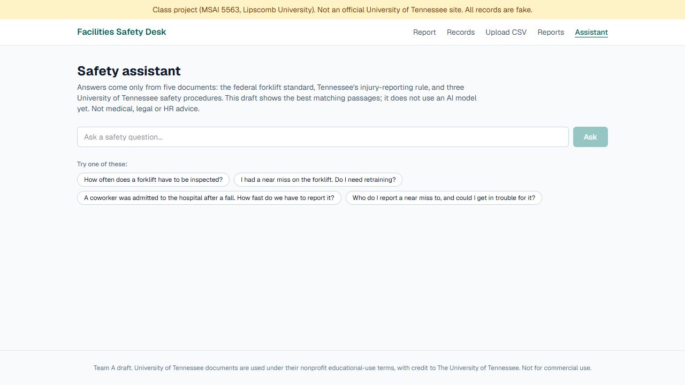
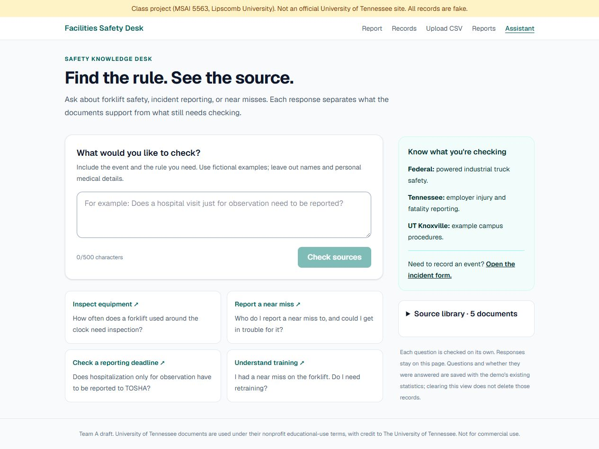
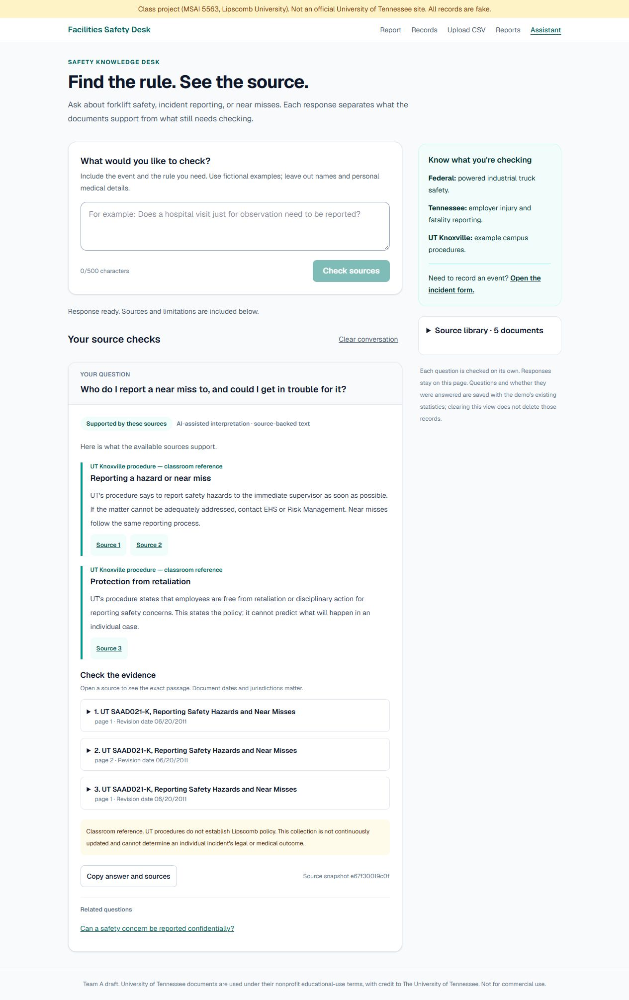

# Assistant draft for team review

> **Status, November 5, 2026.** Written on November 3 for draft pull request #5, which was merged into a side branch and never reached `master`. Its work is now part of one consolidated pull request. This file is kept as the record of what was built and checked on that date, so branch names, pull request numbers, port 3102 and "nothing has been merged" statements describe November 3. For current setup and deployment steps, use the root [README](../README.md) and [DEPLOYMENT.md](DEPLOYMENT.md). **November 12, 2026:** the University of Tennessee reference documents and the five answer guides built on them were retired. The collection now holds the federal forklift standard, the Tennessee reporting rule and the Lipscomb documents a Safety manager uploads.

The original assistant returned matching passages, sometimes missing the actual answer, a second part of a question, or a source exception. This draft adds a source-backed answer guide, optional local AI interpretation, and a clearer evidence interface. It remains a classroom prototype using fictional examples.

## What changes

- Fourteen source-backed topics cover inspections, training, unsafe equipment, incident/hazard reporting, confidentiality, retaliation, Tennessee reporting conditions, retention, and unattended forklifts.
- Every guide section links to full source passages. Federal rules, Tennessee employer requirements, and UT Knoxville procedures have distinct scope labels.
- Unsupported jurisdictions, missing local policies/contacts, product-specific chemical advice, medical/HR requests, and incident-record lookups are kept outside the supported answer path.
- A return-to-work clearance question stays partial even if the model considers the policy sufficient. More than four selected topics also produces partial coverage.
- Optional Ollama interpretation maps paraphrases to supplied topics and can select exact candidate passages for other questions. Selected IDs must exist in the supplied catalog. The model cannot write the displayed policy text, fabricate citations, or call tools. Generic passage selections remain partial, with surrounding text visible.
- Model failure, malformed output, an occupied interpreter, or timeout falls back explicitly to the source guide/search. The endpoint has a bounded JSON body and cross-site request checks. These checks are not authentication.
- The interface provides clear supported/partial/unsupported states, expandable evidence, source-library links, copy with citations, related questions, cancellation, retry and accessible status messages. Questions are independent. Clearing the visible conversation does not erase existing question-statistics records.

## Sources and provenance

`src/data/documents.json` is preserved. An additive supplement restores the second paragraph of OSHA 1910.178(q)(7), omitted in the original extraction, about round-the-clock inspections after each shift and correcting defects. It was checked against [OSHA's official text](https://www.osha.gov/laws-regs/regulations/standardnumber/1910/1910.178) on November 3, 2026. Citation labels for combined excerpts are expanded to describe their actual section range. Existing UT dates and attribution remain visible; the corpus is not described as continuously current.

Answer-guide wording is an AI-prepared interpretation for team review, not newly issued policy. The source snapshot hash identifies the supplied evidence and guide text; it is not a claim that all laws were revalidated. The source guide uses fixed, cited summaries; it is not unrestricted generative legal advice.

The local adapter follows [Ollama's structured-output interface](https://docs.ollama.com/capabilities/structured-outputs). `ASSISTANT_OLLAMA_MODEL` enables an installed model. The endpoint is fixed to loopback, with an 8K context, bounded output, 45-second request timeout, one interpreter request at a time, and a short in-memory cache. The launcher warms the model before presenting the app. A cold initial call timed out in testing; warm interpretation was observed to complete within seconds. There is no public tunnel or automatic remote AI provider.

## Validation and honest limits

Observed locally: 38 assistant/contract checks passed, 3 report-storage regressions passed, and lint, TypeScript and the production build passed. The 31-case development comparison passed all revised cases. Twelve additional live-model paraphrases and five HTTP boundary checks were exercised. The final return-to-work and missing-training-duration checks remained partial; battery questions selected exact source excerpts. This is development evidence, not independent user acceptance or a general accuracy percentage.

Desktop and 320/393/768px checks showed no horizontal overflow. Browser checks confirmed focus on the new response, opening the cited passage directly, copying source links and scope, and keeping the question after cancellation.

### Visual comparison

Original assistant:

Revised assistant:

A working two-part answer with sources:

The original eleven proposed team cases are preserved in `tests/original-test-questions.json`. Twenty additional development cases cover source exceptions, scope, misconceptions and unsupported requests. The evaluation checks expected support status, required phrases and source identity; it does not establish general accuracy or independent user acceptance. The original retrieval implementation is saved as a test fixture from commit 7bef38e for reproducible comparison.

Separate live-model paraphrases test semantic interpretation through the HTTP endpoint. A question asking whether an old certificate permits an operator to go straight back to work intentionally receives partial coverage: the policy cannot grant individual clearance. Model verdicts were observed to vary when prompt context changed, which is why this boundary is enforced in application code. Source evidence selection is also constrained independently of the model.

Tests cover malformed model output, invented IDs, failed model requests, exact evidence identity, JSON size/type/origin boundaries, and preservation of the report-form storage behavior. Browser checks cover desktop and mobile, source expansion, multi-part answers, unsupported questions, cancellation, copy, and question retention. Evidence and machine-readable evaluation results are in the local ignored `test-results` folder.

This does not add sign-in, role enforcement, an editable source library, full response-history storage, continuous policy updates, or a hosted model. The local interpreter depends on this computer and Ollama. A team-approved hosted provider or worker would be a separate deployment decision. The app is not ready for real personnel or incident data.

## Integration with the database draft

This PR is based on the report-form branch, so its review diff isolates assistant work and its preview can run without Catherine's database. When combining with PR #3, retain the database branch's `saveQuestion(database(), question, result.answered)` behavior in the new route, and remove client-side `logQuestion`. Keep the new answer service and request limits. Test policy answers independently from metric-storage failures; a failed metric write should not conceal a valid answer. Repeat the actual hosted two-browser checks after team review and database setup.

AI-assisted implementation by Codex at Forrest's direction. No student hours, independent user testing, team agreement or production approval are implied.

## AI-written answers (added November 12, 2026)

Optional, and off unless `ASSISTANT_CLAUDE_API_KEY` is set. Asked for by the instructor and agreed by the team on November 12.

**How a question is handled when it is on**

1. The scope rules run first, unchanged. A question about pay, another state, an individual's clearance to work, or an instruction to ignore the rules is declined and never reaches the model.
2. A question that a tested source guide answers keeps that guide, unless the closest passage comes from an uploaded document. The organization's own text comes first.
3. Otherwise the search picks up to eight passages: best first, at most three from one document and two from the bundled regulations while other documents have passages to offer. A question that asks who to call or how to report something gives extra weight to passages that hold a phone number or an email address. A question with more than one part ("There is a fire. Who do I call, and where do I go?") also brings up to three of the passages that sit within two places of the best one in the same document, because the second part often shares no words with the passage that answers it; those take the places of the weakest picks.
4. The question and those passages go to Claude with a fixed set of rules. The reply is JSON: whether the passages answer the question in full, in part or not at all, and one to four points, each with the passages it rests on.
5. The reply is checked in code (`src/lib/assistant/written-answer.ts`). Each point must cite a passage that was sent. Every number in a point, with the unit it counts, must be in a passage that point cites; "2 business days" is not supported by a passage that says "2 days". The same holds for quoted phrases, phone numbers, email addresses and links.
6. A reply that passes is shown as "AI-written" with the cited passages. Anything else (a failed check, a refusal, a timeout, an error, or the model saying the passages do not answer) shows the passages as before. A failed call is not retried.

When passages disagree, the rules tell the model to say so and to give what each document says, the newer one first. It is not told to pick one. Seven of the uploaded Lipscomb documents carry no date, and in one known case the newer document is the one that contradicts itself.

**What the checks do not catch**

- A number that is in the cited passage but belongs to a different rule in it.
- A sentence with no number, quote or contact detail that says more than the passage does.
- A passage the search did not find. The model can only use what it is sent.

The cited passages are always shown with the answer for that reason, and the note under an AI-written answer asks the reader to open them.

**Tested, and not tested**

`npm run test:claude` (25 tests) and `npm run test:claude-path` (9 checks through the running app) use a stand-in for the model. They prove the plumbing and the checks. They say nothing about how well a real model answers. `npm run eval:claude` runs a question set against the real API and reports results, tokens, cost and time per model. It was run on November 15, 2026 with 23 private questions on a copy of the live site's 20 uploaded documents. Claude Opus 5.5 met all 23 expectations: 16 written answers that passed every check, one question correctly left unanswered, six that never reached the model. Claude Haiku 5.5 met 22: one of its 16 replies failed a citation check and the passages were shown instead. Opus cost about 2.9 cents per answer and Haiku about 0.07 cents; `docs/DEPLOYMENT.md` has the table. Twenty-three questions show that the path works and how the two models compare. They are not a measure of accuracy in general.

With the live site's 20 Lipscomb entries copied to a development computer (931 passages), 16 test questions have an answer in them. The passages sent to the model included the passage that holds the answer for all 16. The on-page search, which shows three passages, did so for 14. For nine of ten questions about a point where documents disagree, or about the chemical inventory, every document involved was among the passages sent. This measures the search, not the model.

AI-assisted implementation by Claude at Forrest's direction. No student hours, independent user testing or production approval are implied.

## Semantic search (added November 15, 2026)

Optional, and off unless `ASSISTANT_EMBEDDINGS_API_KEY` is set. The spec names it ("Embeddings: Voyage or similar"), and the instructor asked on November 12 about a vector database behind the assistant.

Keyword search finds a passage only when the question uses the document's words. A question that says "musty" and "dark spots" does not find a procedure that says "mold". Semantic search compares meanings instead: every passage and every question gets an embedding, a list of numbers made by an embedding model, and passages whose numbers are close to the question's are close in meaning.

**How a question is handled when it is on**

1. The scope rules run first, unchanged. A declined question is sent nowhere.
2. A question that a tested source guide answers keeps the guide. That is decided by the keyword ranking alone, as before, and such a question is not sent to the embeddings provider.
3. A question none of whose words occur in any active passage, such as a greeting, is not sent either.
4. Otherwise the question is embedded (one request, 2.5 seconds at most) and compared with every passage it may draw on. Passages shorter than 120 characters are left out. The eight closest are merged with the keyword matches by reciprocal rank fusion: a passage scores 1 / (60 + its place) on each list it is on, and the scores are added. Only places count, so the two lists' own scores never have to be compared. A passage on both lists comes first, and on a tie the keyword match goes first.
5. With AI writing on, the merged list feeds the same choice as before: up to eight passages, at most three per document, two from the bundled regulations, and the neighbors of the best passage for a question with several parts. A passage found only by meaning may be sent, because the model judges whether it answers.
6. Without AI writing, the three passages shown come from the merged list, but only when the keyword match found at least one passage. Meaning can change which passages are shown, never whether any are.
7. Keyword search answers alone, exactly as before, when there is no key, when any passage the question may draw on has no embedding, when the stored embeddings cannot be read, and when the provider fails or is slow. After a failure the provider is left alone for 30 seconds.

**Why there is no similarity threshold**

The first design gave the search a cut-off: only passages that stood out from the rest of the collection would count. It was measured and dropped. On three embedding models, an off-topic question ("Hello, how are you?", a question about the capital of France) had passages that stood out as far as a real question's did. Closeness of meaning can rank passages. It cannot tell "about the same subject" from "answers the question". So something else always decides: the model when it writes, and the keyword match on the page.

**Where the embeddings are kept**

In the app's PostgreSQL database, as plain arrays of numbers, compared in the app. The pgvector extension is not used. `docs/DEPLOYMENT.md`, "Semantic search", gives the reasons and the path to pgvector.

**What was measured**

On a development computer, November 15, 2026, on a copy of the live site's Source library (22 documents, 1,041 passages). No hosted embeddings key was available, so the embeddings came from three models running on the same computer through Ollama: `nomic-embed-text`, `mxbai-embed-large` and `qwen3-embedding:0.6b`. Where the right-hand column gives three numbers, they are those three models in that order.

Two question sets, both private because their answer keys quote documents that are not public: the 29 questions of November 12 to 15, and 30 new ones written before any result was seen. Of the 30, 25 ask in other words than the documents use for something the documents answer, and 5 ask for something the documents do not cover.

Which passages reach the model:

| | Keyword only | With semantic search |
| --- | --- | --- |
| Earlier questions: the passage with the answer is sent (17 questions) | 16 | 16, 16, 16 |
| Earlier questions: every document involved is represented (10 questions) | 9 | 9, 9, 9 |
| Other words: the passage with the answer is sent (25 questions) | 7 | 20, 21, 19 |
| Other words: the on-page search shows it | 4 | 5, 7, 6 |
| Not covered: sent to the model (5 questions) | 2 | 5, 5, 5 |
| Not covered: the page shows passages | 0 | 0, 0, 0 |

Answers from the real API (`npm run eval:claude`). The earlier 23 questions ran with one local model (`qwen3-embedding:0.6b`), the 30 new ones with all three:

| | Keyword only | With semantic search |
| --- | --- | --- |
| Claude Haiku 5.5, earlier 23 questions: handled as expected | 22 | 22 |
| Claude Opus 5.5, earlier 23 questions: handled as expected | 23 | 23 |
| Claude Haiku 5.5, 30 new questions: handled as expected | 11 | 25, 23, 25 |
| Of the 25 the documents answer: a written answer that met its expectation | 6 | 21, 20, 21 |
| Of the 5 they do not cover: left unanswered | 5 | 4, 3, 4 |

What it costs:

| | Keyword only | With semantic search |
| --- | --- | --- |
| Time added to a question before the model is called | none | 25 to 40 milliseconds (the embedding request to a model on the same computer, then the comparison, which takes about 1 millisecond) |
| Earlier 23 questions: model calls and input tokens | 17 calls, 92,445 | 18 calls, 100,681 |
| 30 new questions: model calls and input tokens | 22 calls, 80,679 | 30 calls, about 178,000 |
| Claude Opus 5.5 for the earlier 23 questions | $0.489 | $0.528 |
| Embeddings | none | about 2 to 3 cents once for the whole library and a tenth of a cent per 1,000 questions at Voyage's listed price; not measured |

**What this shows, and what it does not**

- It finds what keyword search misses when the question uses other words: 7 of 25 became 19 to 21, and correct written answers on the smaller model went from 6 to 20 or 21.
- It did not change the questions keyword search already handled: the same passages reach the model, and both models handled the earlier 23 questions as before.
- More questions reach the model, so more is spent there. Every question that passes the scope rules now brings passages, where before a question with no keyword match stopped without a model call.
- A question the documents do not cover is no longer always left unanswered. The model is shown the nearest passages, and for one or two of the five such questions it wrote a partial answer from them (the request procedure nearest to what was asked, or the general reporting line with a remark that the documents describe no such procedure). Every one was marked partial, none as a full answer. With keyword search all five were left unanswered. A rule that withholds a partial answer when all its passages were found by meaning only was tested on these results and not added: it would have removed three to six correct answers in each run to prevent one or two.
- It does not find a single sentence inside a long passage about something else, and the local models did not connect an everyday chemical name to the name on the label.
- The embedding models here are small local ones. Voyage's model was not measured, so its results may differ in either direction.
- 59 questions written by the developer show the direction. They are not a measure of accuracy in general. Three answer keys were widened after first results showed correct answers that the keys rejected; in one of them the search by meaning had found a rule the key did not know about.

AI-assisted implementation by Claude at Forrest's direction. No student hours, independent user testing or production approval are implied.
