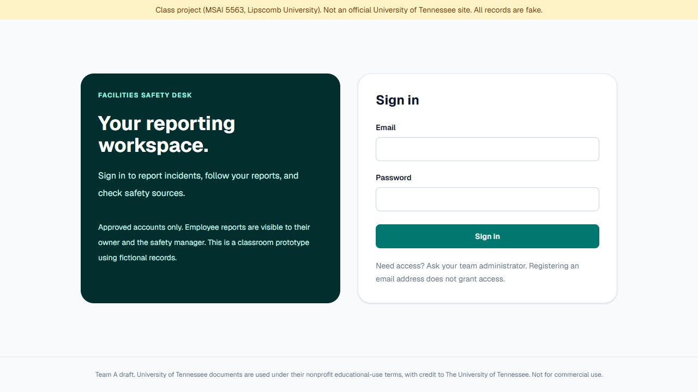
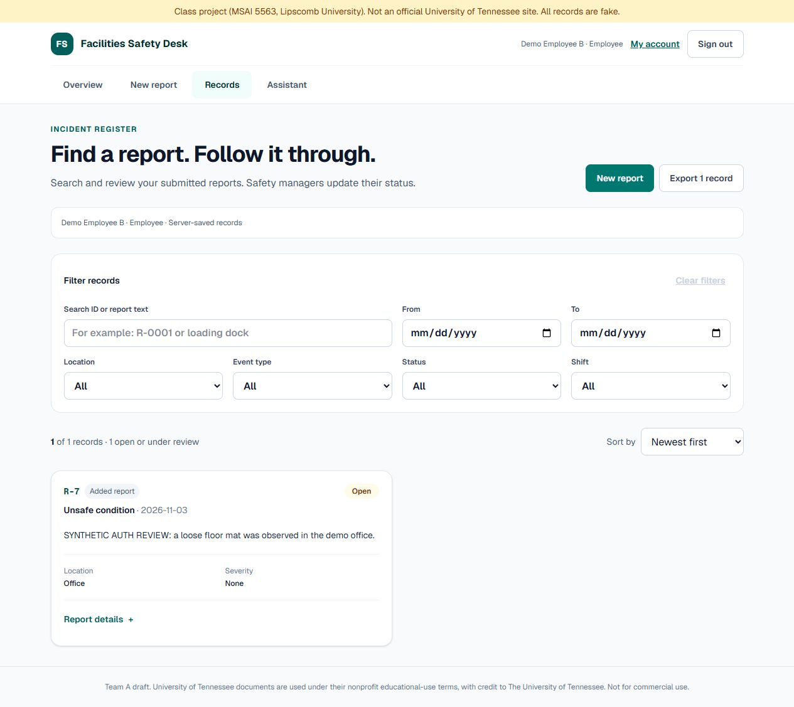
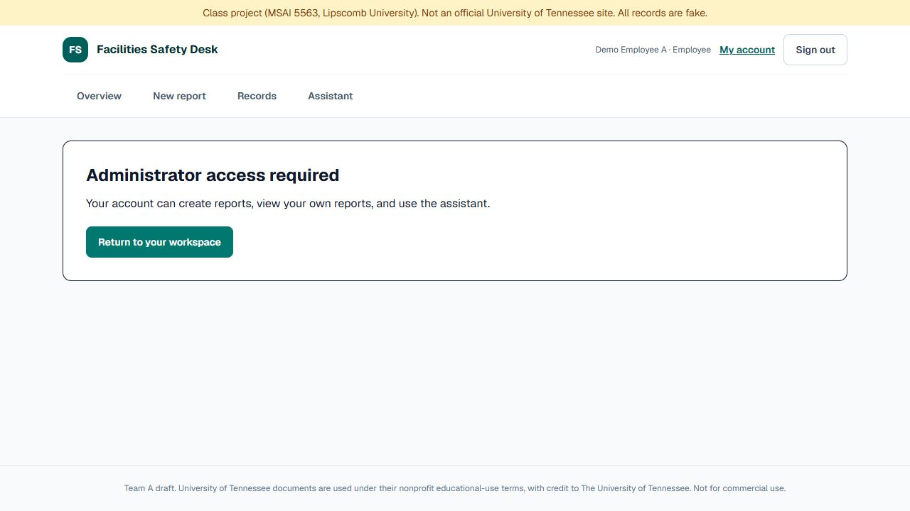
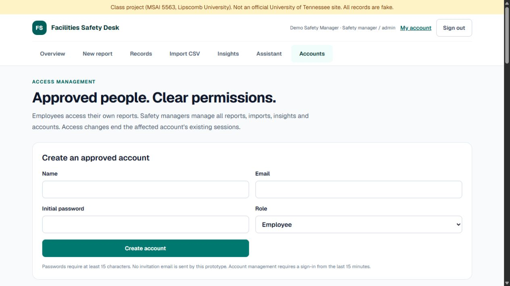

# Sign-in and access controls — draft

This branch integrates the full-app draft (#6) with the Postgres foundation from #3. It replaces browser-owned records with authenticated, server-owned records. It follows the survey's two-role proposal; these roles and actual team accounts still need team approval.

| Capability | Employee | Safety manager / admin |
| --- | --- | --- |
| Sign in, sign out, change own password | Yes | Yes |
| Submit a report; use the source-backed assistant | Yes | Yes |
| Read/export reports | Own reports only | All reports, including unassigned sample/legacy records |
| Change report status | No | Yes, with stale-update protection |
| Bulk import; view insights and question statistics | No | Yes |
| Create, disable, or change account access | No | Yes; fresh sign-in required |
| View the audit log | No | Yes |

## What is enforced

- Better Auth 1.7.16 handles password hashing and database-backed sessions. Session cookies are HttpOnly, SameSite=Lax, host-scoped, and Secure when the configured origin is HTTPS. Sessions expire after eight hours, with activity-based renewal. Cookie caching is disabled.
- Every record, import, statistics and account endpoint checks the server session. Ownership is assigned from that session, never from a supplied email, role or owner ID. Inaccessible report IDs return 404.
- Public signup and the library's broad admin/impersonation HTTP endpoints are not exposed. Email domains confer no privileges. Only an authenticated administrator can provision accounts through the app.
- Administrative account changes require a sign-in from the last fifteen minutes. Administrators cannot demote/disable themselves. Role changes and disabling an account revoke its sessions immediately. Password changes require the current password and revoke other sessions.
- Passwords require at least fifteen characters. Sign-in has database-backed rate limiting and an additional per-account attempt limit. The auth secret is generated randomly for local review; there is no default production secret.
- Requests have JSON size limits, origin checks and server-side validation. Request retries are scoped to the initiating user; importing is transactional and deduplicates on the server.
- Access changes, account creation, report creation/import and status changes are audited. Audit responses contain neither credentials nor session tokens.
- Form drafts are scoped to the signed-in account and cleared on sign-out. Records and question statistics are no longer read from localStorage. Old browser data is preserved for deliberate export/import through the earlier draft; it is not automatically assigned to a new account.

## Local review

Use Node.js 24, matching the verified workstation runtime:

```powershell
npm ci
npm run auth:local
```

Open http://127.0.0.1:3103 . The launcher creates an isolated PostgreSQL database on port 54331, applies versioned migrations, seeds fictional records once, and provisions three fictional review accounts. It then builds and starts the app. Ctrl+C stops the owned app/database processes without deleting their data.

Generated credentials are in `.local/review-accounts.json`; the auth secret and loopback connection are in `.env.local`. Both paths are ignored by Git. The current workstation copies are restricted to the Windows user and SYSTEM. The launcher refuses a hosted database and never runs on Vercel. It does not create accounts for Catherine, Kai or Forrest.

The accounts are `admin@demo.invalid`, `employee-a@demo.invalid`, and `employee-b@demo.invalid`. Passwords are random and are not included in this document, screenshots, source control or console output. Existing review passwords are retained across restarts.

The earlier public draft remains available separately on port 3102. No production deployment or merge has been performed.

## Verification

`npm run test:access` runs HTTP checks against the isolated local app. It creates fictional reports and disabled temporary test accounts; it resets only local rate-limit counters so review can continue. The suite verifies anonymous denial, real password login, cross-user record isolation, forbidden status/import/admin actions, forged-cookie rejection, idempotent retries, owner forgery, CSRF rejection, stale updates, account disabling, role-change revocation, password change/other-session revocation, session expiry, hashing, logout revocation and rate limits.

The existing app/CSV and assistant cases remain in place. The body-boundary unit check now exercises parsing after authentication, and the live test retains the empty-question rejection for a signed-in user. Configuration checks confirm missing secrets fail closed and HTTPS selects Secure cookies. The production dependency audit reported zero known vulnerabilities at implementation time; this is not a penetration-test claim.

Browser review covers employee sign-in, own-report visibility, hidden admin navigation, direct admin-page denial, logout, administrator sign-in, and account-management visibility. No real personnel data or real team credentials were used.

Observed result: 23 HTTP access scenarios passed, as did 19 app/CSV checks, 38 assistant checks and the auth configuration check. Lint, TypeScript and the production build passed. Sign-in, employee records and account management were checked at 320px with no horizontal overflow. Employee B submitted report R-7 through the actual form and saw only its own record, with no status editor.









## Hosting handoff

The project owner must supply an isolated Preview database and explicitly approved accounts before a shared test:

1. Configure `DATABASE_URL` (and `DATABASE_URL_UNPOOLED` for migrations if provided), a randomly generated `BETTER_AUTH_SECRET` of at least 32 characters, and `BETTER_AUTH_URL` set to the exact HTTPS deployment origin. No secrets may use a `NEXT_PUBLIC_` prefix.
2. Apply `npm run db:setup` against that reviewed target. Migration 001 preserves the earlier database foundation; 002 is generated from the pinned auth package; 003 adds ownership, auditing and attempt limits. Existing incidents without an owner remain admin-only. Test Preview separately from Production.
3. Provision the first approved administrator from a secure operator environment with `FSA_ALLOW_ADMIN_BOOTSTRAP=1`, `FSA_ADMIN_EMAIL`, `FSA_ADMIN_NAME`, and `FSA_ADMIN_PASSWORD`, then run `npx tsx scripts/bootstrap-admin.ts`. The script refuses to create a bootstrap admin if an active admin already exists. Remove bootstrap variables afterward.
4. Sign in over HTTPS and repeat the two-user isolation, cookie, logout and account-revocation checks on the hosted preview. Review the diff and agree the roles before merging.

Unconfigured deployments can build and show the sign-in screen, but authentication/data access fail closed. No public demo password or unauthenticated fallback is provided.

Not implemented: university SSO, MFA, invitation/reset email delivery, automatic identity verification, enterprise audit retention, or a completed hosted security review. These remain relevant before real people or real incident data use the system. No emails or messages were sent.

References: [Better Auth setup](https://better-auth.com/docs/installation), [Next.js integration](https://better-auth.com/docs/integrations/next), [session management](https://better-auth.com/docs/concepts/session-management), and [Next.js authentication guidance](https://nextjs.org/docs/app/guides/authentication).

AI-assisted implementation by Codex at Forrest's direction. No student hours, team acceptance or production approval are implied.
