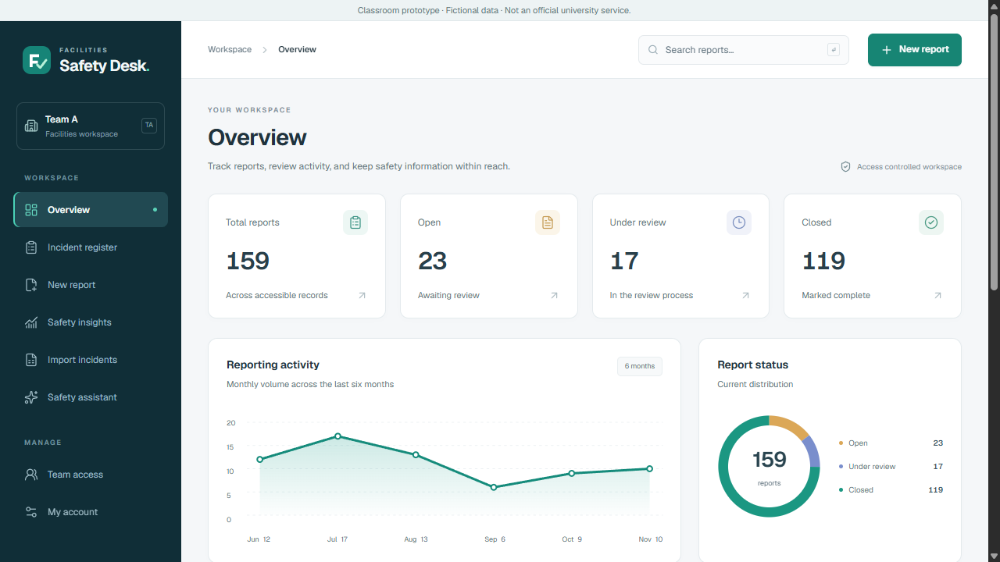
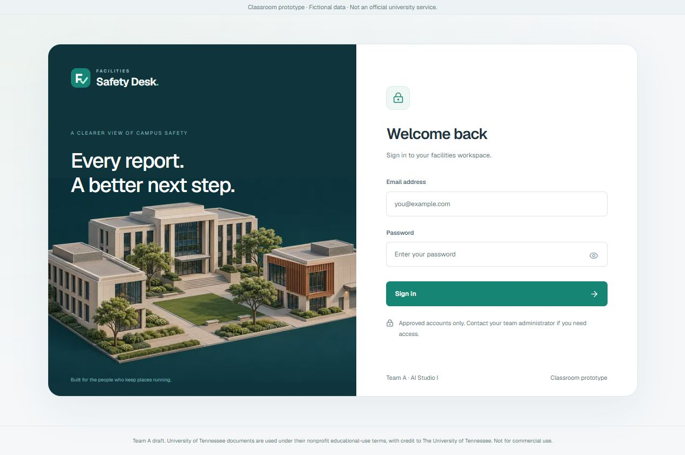
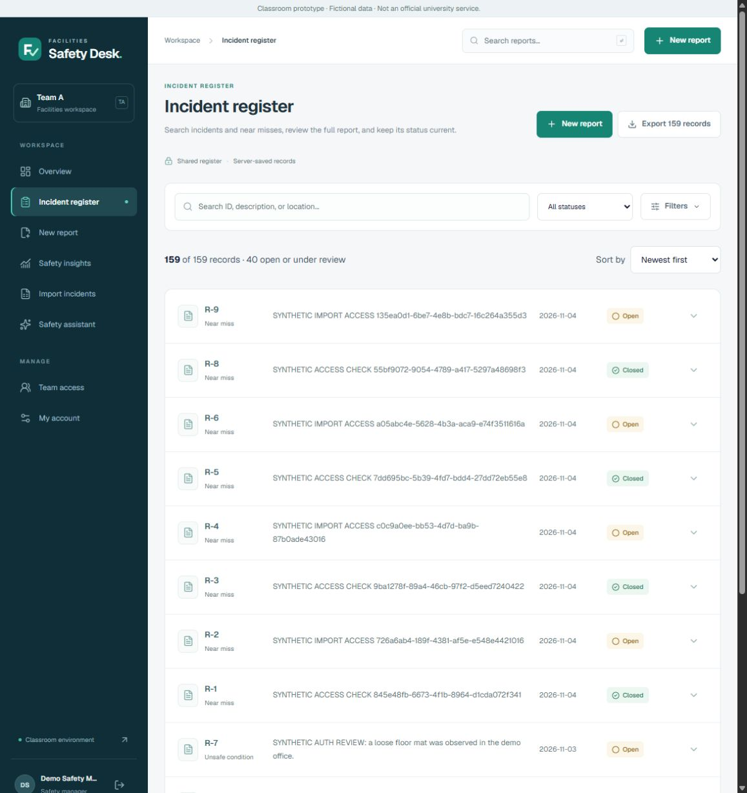
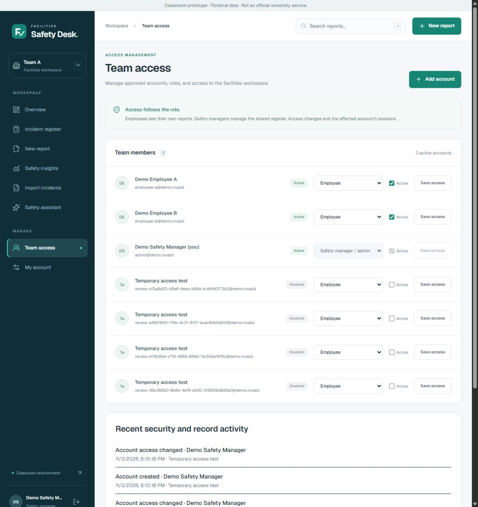

# Product design draft

This pass turns the existing application into a more coherent facilities-management product. It keeps the project name, authentication, two-role permissions, source material and server data behavior. It is a visual and interaction proposal for team review, not a claim of feature parity with an enterprise EHS platform.

## Reference direction

- [Cority incident management](https://www.cority.com/corityone/incident-management-software/) provided a reference for clear workflow groupings, incident capture and enterprise product presentation.
- [VelocityEHS incident management](https://www.ehs.com/solution/safety/incident-management/) provided a reference for connecting reporting, follow-through and analytics in one workspace.
- [SafetyCulture's frontline guide](https://assets.ctfassets.net/wum34wy9buzj/2JsRvVzB5bv6GZtCWiy8eg/757d2dd0eac8e678b30a34c77cf0fa00/SafetyCulture_Frontline_User_Training_Guide__Two_Page____Nov_24_-Generic_Version-_.pdf) provided a reference for quick actions, clear navigation and resuming work.

These were public product/workflow references. No competitor branding, interface artwork, logos, customer claims or proprietary assets were copied.

## Design and interaction changes

- Persistent desktop navigation, compact header, breadcrumbs, account identity, and a keyboard-accessible mobile navigation dialog.
- A new original mark, a consistent Lucide icon set, a restrained teal/ink palette, smaller page headings, readable secondary text and more consistent spacing, surfaces and controls.
- A live overview with report counts, a six-month volume chart, status distribution, recent reports and useful next actions. No fabricated percentage improvements, risk scores or notifications.
- Global report search and clickable overview metrics open the register with actual filters. The register uses compact rows and expandable details. Advanced filters can be revealed when needed.
- Team management starts with members, with account creation in a focused dialog. Audit activity initially shows a short list with a real Show more action.
- A branded sign-in screen with original campus illustration, password visibility toggle and the existing approved-account login flow.
- Small hover/active transitions, visible keyboard focus, and reduced-motion support. Existing data and permission checks remain authoritative.

## Asset manifest

| Asset | Location | Source |
| --- | --- | --- |
| Campus illustration | `public/brand/campus-illustration.png` | Original image generated for this project using the built-in image-generation tool |
| Brand mark | `public/brand/mark.svg` and `src/app/icon.svg` | Original code-native SVG mark |
| Interface icons | `lucide-react` 1.67.0 | ISC / applicable MIT license; full notices at `public/brand/lucide-LICENSE.txt` |
| Design tokens and layout | `src/app/product-design.css` | Project-owned CSS |

The illustration is decorative, depicting a generic campus rather than a real university site. It uses Next.js image optimization and explicit responsive sizes. A tested optimized WebP response was approximately 36 KB; the original PNG remains available as the source asset. No external image host is needed at runtime.

### Full image-generation prompt

Built-in tool mode; new generation; opaque background. No input image or competitor asset was supplied.

> Create a polished editorial 3D architectural illustration for the sign-in screen of a university facilities safety management web app. A compact, generic university campus courtyard with three modern ivory stone and pale concrete academic buildings, one restrained copper accent facade, dark navy windows, a few sculptural green trees, precise pedestrian walkways and a small service entrance. No people, no vehicles, no logos, no words, no letters, no interface elements or badges. Isometric elevated perspective, carefully crafted small-scale architectural model, soft natural shadows, subtle tactile materials, refined professional art direction. Deep midnight teal background (#102e36) gently fading into a slightly lighter teal surface, ivory structures and muted sage foliage. Calm, premium enterprise software brand asset, sophisticated and believable rather than toy-like. Wide landscape composition, campus centered with breathing room around all edges, useful as a large visual alongside a sign-in form. Crisp architectural edges, restrained palette, beautiful lighting.

## Review screens

## Verification and limits

The existing 58 unit/regression checks and 23 HTTP access scenarios passed during this pass. Browser checks cover global search, metric filters, expandable report details, password visibility, mobile navigation, account-dialog dismissal and responsive layouts. Image loading and the optimized asset response were verified. This is not an independent usability study or accessibility certification.

The subsequent [readiness draft](READINESS_REVIEW.md) implements local MFA, private administrator-assisted recovery and source management. Hosted configuration, actual team accounts, SSO and email delivery remain incomplete. No production merge, teammate role assignment or student hours are implied.
