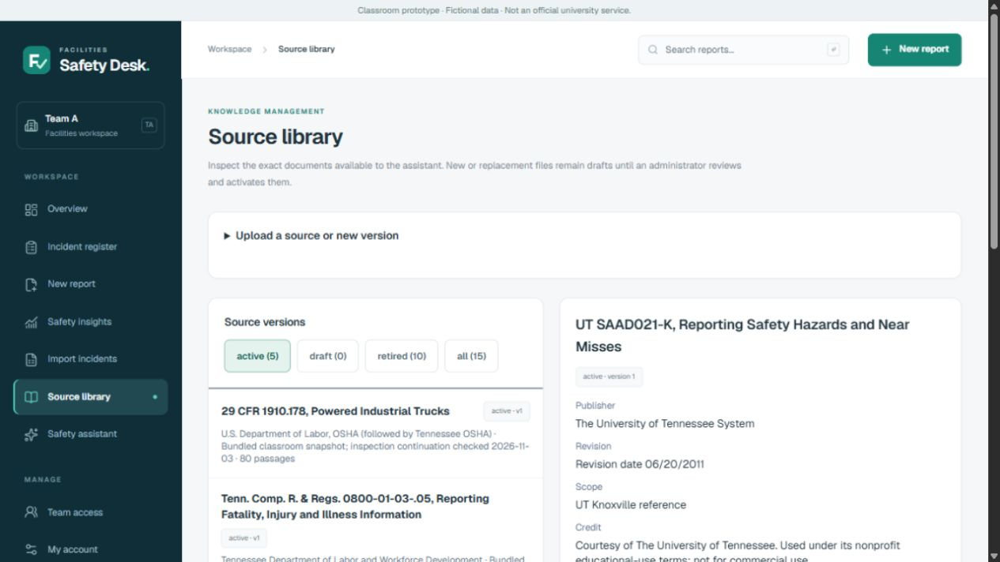
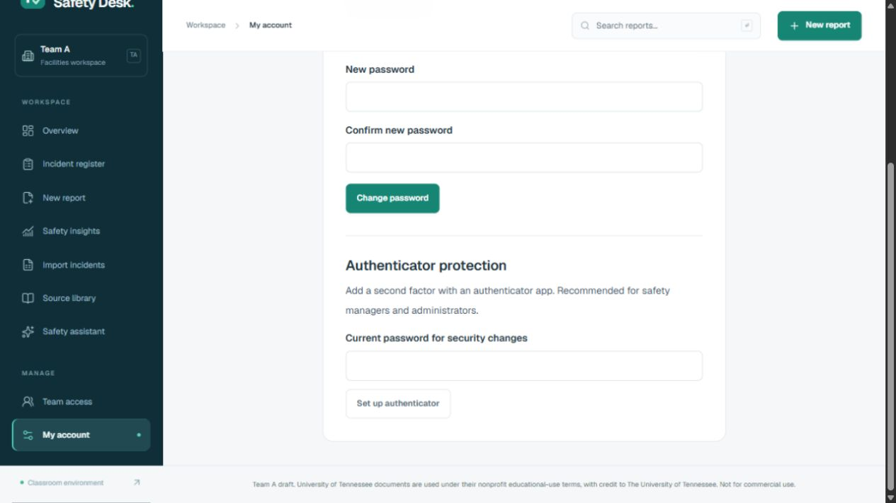

# Prototype readiness — team review draft

> **Status, November 5, 2026.** Written on November 3 for draft pull request #9, which was closed without merging. Its work is now part of one consolidated pull request. This file is kept as the record of what was built and checked on that date, so branch names, pull request numbers, port 3102 and "nothing has been merged" statements describe November 3. For current setup and deployment steps, use the root [README](../README.md) and [DEPLOYMENT.md](DEPLOYMENT.md). What this file says about preview deployments is superseded by "Previews that can sign in" in DEPLOYMENT.md (November 8).

Review date: November 3, 2026, America/Chicago. This branch is stacked on the product-design draft (#8). It preserves Catherine's project and Kai's planning role: the changes are proposals for team review, not approved scope, assigned teammate work, or a production release. Implementation and development testing were AI-assisted at Forrest's direction; they do not establish his personal testing, hours, team acceptance or an independent safety review.

## Working changes

**Account security.** Users can enroll an authenticator, verify a six-digit code, save one-use backup codes, and use either method at sign-in. Password-only sessions cannot access protected data after MFA is enabled. Successful enrollment revokes older sessions, and the server records second-factor completion explicitly on each verified session. This replaces a timestamp comparison that failed intermittently when events shared a timestamp. Incorrect codes remain on the challenge screen so users can retry. Authenticator changes require a fresh sign-in and the current password. Sessions expire after eight hours without activity-based renewal.

**Account recovery.** A freshly authenticated administrator can issue a private, one-time, 30-minute recovery link for another approved active account. The database stores a hash, not the token. The token travels in a URL fragment and is removed from browser history by the recovery page. A successful reset consumes outstanding recovery links, revokes sessions and preserves MFA. Concurrent redemption succeeds only once. No email service is configured; the administrator must verify identity and deliver the link privately. An administrator cannot issue their own recovery link. Losing the only administrator's password or all MFA recovery factors still needs a verified operator procedure; no public bypass exists.

**Source library.** Administrators upload PDF, UTF-8 text or Markdown as draft versions, inspect metadata and extracted text, and explicitly activate or retire a version. Employees see only active sources. Versions and original uploaded bytes remain available to administrators; activation retires the previous version atomically. Limits are 5 MB, 100 PDF pages and 200,000 extracted characters. Scanned documents need OCR beforehand. PDF parsing has a bounded text-extraction wait. The uploader supplies publisher, revision, applicability, original HTTPS URL and usage credit; uploading does not independently establish authority or permission.

**Source-backed assistant.** Retrieval, source guides, model candidate IDs and cache keys now use the active catalog. Retired passages cannot return through a static guide or cached response. If the catalog changes during a request, the response is regenerated against the latest catalog. Explicit UT, federal and Tennessee scope is respected. A model-selected broad guide cannot suppress strong retrieved evidence for a more specific condition. Generic excerpts stay marked partial; the app does not invent a complete answer from an excerpt. Original classroom source text and acceptance cases are preserved. Current Lipscomb contacts, SDSs and local procedures still require reviewed local sources.

**Data recovery.** The backup tool takes a consistent PostgreSQL snapshot and encrypts it with AES-256-GCM. It includes accounts, password hashes, MFA settings, reports, source versions and audit history, but excludes sessions, pending verification challenges, rate limits and recovery links. Restore requires a new empty UTF-8 database, matching migration checksums and the original auth secret. It refuses to overwrite existing tables. The local Windows database was migrated from WIN1252 to a separate UTF-8 database with row counts and sequence state checked; the original database remains intact. New local clusters initialize as UTF-8.

## Observed verification

| Check | Result and limits |
| --- | --- |
| App/CSV regressions | 19 passed |
| Assistant regression cases | 40 passed |
| Catalog tests | 23 passed, including 18 frozen challenge cases |
| Auth configuration and MFA client error handling | 2 passed |
| Live-model challenge | 18/18 passed on the installed local model; development cases, not a general accuracy estimate |
| HTTP access scenarios | 23/23 passed on the current local app |
| MFA and recovery | 7 grouped scenarios passed, with the enrollment/recovery suite repeated after fixing the intermittent session issue |
| Source lifecycle | 6 grouped scenarios passed; real archived PDF parsing was also exercised before replacing the suite fixture with a portable synthetic PDF |
| Concurrent writes | Ten identical requests created one record; ten different requests had unique IDs; competing status edits returned success/conflict; snapshot references remained consistent |
| Encrypted restore | Table hashes and sequences matched in a separate scratch database; restored admin password worked; sessions/recovery links were absent; tampering, wrong key and nonempty target were rejected |
| Build and dependencies | Production build, TypeScript and lint passed; production dependency audit reported zero known vulnerabilities at this check |
| Browser workflow | Draft upload → extraction review → activation → exact cited answer → retirement → fresh answer withheld; account security screens and mobile layouts inspected |

The frozen challenge initially passed 9/18 without the live model. The first live run passed 16/18, and an intermediate refinement passed 17/18 before the final 18/18 run. These earlier receipts are retained in `docs/verification/`; expectations were not edited to hide failures. The cases were written during development and then used to improve the implementation, so an independent unseen-question evaluation is still needed. Warm local timing is not a hosted performance guarantee.

The browser source test used clearly fictional text and retired it afterward. The original five classroom sources remain active. No real user's MFA was enrolled, no actual recovery link was delivered, and no student hours or participation were recorded.

## Run and verify locally

Use Node.js 24. Run `npm ci`, then `npm run auth:local`, and open `http://127.0.0.1:3103`. The launcher owns its isolated PostgreSQL instance on port 54331 and the app process. Stop it with Ctrl+C. Existing data and local review credentials are retained. `.env.local`, `.local` and `.test-db` are ignored by Git; never include them in a shared source archive. On this workstation, their containing private folders are restricted to the Windows user and SYSTEM.

For separate app/database processes, `npm run auth:db` starts only the local database. Run `node --env-file=.env.local --import tsx scripts/db-cli.ts setup` to apply all six migrations, then build and run Next with the same environment. The generic `npm run db:setup` expects the operator to supply environment variables; it does not silently choose a database.

Run the checks listed in the README. Live suites are restricted to the isolated loopback database and must run sequentially because they mutate fictional fixtures and local rate-limit state. They leave disabled test accounts and retired source versions as auditable evidence. `tests/fixtures/source-document.pdf` is original synthetic text and needs no private archive path. The optional local Ollama adapter uses the installed `qwen3.6:35b-a3b` model; it does not download a model. With it unavailable, the source guide/search remains usable and discloses the fallback.

## Back up and restore

`npm run backup` writes an encrypted file under `.local/backups`. The local key is `.local/backup.key`. Preserve that key and the original `BETTER_AUTH_SECRET` separately from the encrypted backup; a source-code ZIP is not a database backup. A hosted operator must supply a separately stored `FSA_BACKUP_KEY` that decodes from base64 to 32 bytes. Backup files contain sensitive account material even though encrypted and must not be committed or put in the team's general Drive folder.

To restore, use the application revision whose migrations match the backup, supply the original auth secret and backup key, set `FSA_ALLOW_RESTORE=1` and `RESTORE_DATABASE_URL` to a newly created empty UTF-8 database, then run `npm run restore -- <encrypted-backup-path>`. Verify the restored deployment before switching traffic. Existing sessions and recovery links intentionally stay invalid; users sign in again. `npm run test:restore` rehearses this on a uniquely named local scratch database, checks content hashes and authentication, and removes only that scratch database after closing its connections. No unattended backup schedule or off-device retention service has been configured.

## Remaining owner and team work

1. The Vercel project owner supplies an isolated Preview PostgreSQL connection, exact HTTPS `BETTER_AUTH_URL`, random `BETTER_AUTH_SECRET`, and approved account identities. Apply migrations and bootstrap the first approved administrator as described in `AUTH_REVIEW.md`. Keep Preview separate from Production.
2. Actual users enroll their own authenticators and store their own backup codes. Agree identity verification and recovery ownership, including the only-admin/lost-factor case, before using real accounts or incident information.
3. Run hosted two-user isolation, MFA, upload, recovery, logout and backup/restore acceptance. `npm run test:hosted` is prepared for an explicit HTTPS origin and approved review account through `FSA_SMOKE_BASE_URL`, `FSA_SMOKE_EMAIL`, and `FSA_SMOKE_PASSWORD`; it checks cookie/cache/logout behavior and stops when MFA requires a person. It has not been run against Catherine's hosted application.
4. Catherine, Kai and Forrest review the draft, agree scope and roles, test unfamiliar questions and real user workflows, and decide what to merge. No reviewer or teammate has been assigned work by this change.

University SSO, email invitation/recovery delivery, an approved hosted model endpoint, production monitoring/alerts, off-device backups, independent security/accessibility review and real-user usability evidence remain absent. These are practical reasons this is a stronger classroom prototype rather than a defensible 9.98/10 production claim.

Implementation references: [Better Auth two-factor plugin](https://better-auth.com/docs/plugins/2fa), [Better Auth sessions](https://better-auth.com/docs/concepts/session-management), and [pdf-parse source and usage](https://github.com/mehmet-kozan/pdf-parse).
